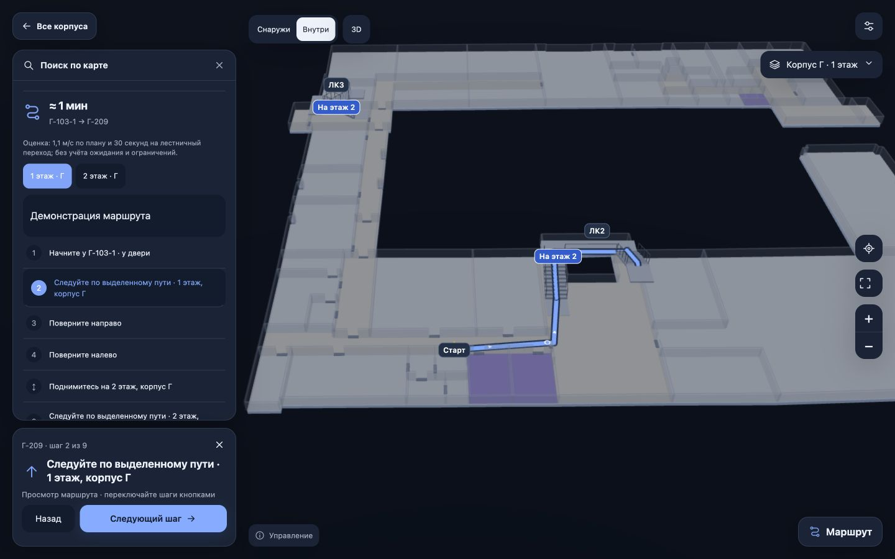

# Компьютерная веб-версия 0.5.15

Новый проход от 10 ноября 2026 года. Цель — удобная работа в настольном браузере при сохранении мобильной компоновки.

## Изменения

- Поиск, карточка места и список шагов размещены в левой колонке. Панель сворачивается до кнопки поиска. Подсказки используют одну прокручиваемую область вместо вложенных списков с отдельной прокруткой.
- Карточка текущего шага с кнопками «Назад» и «Следующий шаг» находится под списком. При построенном маршруте скрываются повторяющаяся форма ввода и лишняя кнопка «Весь маршрут»; изменить точки можно через действия маршрута.
- Камера учитывает фактическую ширину боковой панели. Высокая карточка маршрута больше не отнимает нижнюю часть всей карты при подборе масштаба.
- Левая кнопка мыши перемещает карту и в 2D, и в 3D. Правая кнопка или Shift + левая поворачивают 3D. Колесо и прокрутка трекпада меняют масштаб; сенсорные жесты сохранены.
- Ctrl/⌘ K и / открывают поиск. Стрелки и Enter выбирают подсказки. При фокусе на карте стрелки перемещают её, +/− меняют масштаб, 0 показывает целиком. Клавиши не перехватывают ввод текста или открытый диалог. Памятка доступна по кнопке «Управление».
- Маршрут между аудиториями на ПК открывается кнопкой «Посмотреть шаги» без запроса GPS. «Маршрут сюда» предлагает выбрать начало, если текущая точка ещё не определена. Начало от своей точки и включённое пользователем ведение по геопозиции сохраняются.

## Проверка этого прохода

- `npm run check`: форматирование, 775 автоматических тестов и производственная веб-сборка успешно выполнены. Журнал: `.native-build/desktop-2026-11-10/check.log`.
- Новые и обновлённые проверки охватывают мышь после переключения 2D/3D, сочетания клавиш, отсутствие случайного GPS при просмотре шагов, переходы вперёд/назад и восстановление панели при смене размера.
- В браузере проверены окна 1440×900, 1280×720 и 800×600: поиск с клавиатуры, карточка аудитории, сворачивание панели, 2D/3D, справка и маршрут Г-103-1 → Г-209. Дополнительно устранено перекрытие верхних кнопок прозрачной областью заголовка.
- В размерах 390×844 и 844×390 проверены мобильные формы ввода и подсказки. Это проверка размеров браузера на Mac, не испытание настоящей клавиатуры iOS/Android или датчиков телефона.
- Геометрия, исходные планы и граф проходов не изменялись. Этот проход не подтверждает точность помещений, GPS или доступность всех маршрутов в вузе.

## Распространение

Исходники предназначены для `main`, публикация — для существующего сайта GitHub Pages. Публикуется сборка с `BUILD_BASE=/mirea-v78-map/`. Результат проверки файлов опубликованного сайта сохраняется отдельно в `.native-build/desktop-2026-11-10/public-verification.json`.

Новые Android APK и iOS-приложения в этом проходе не собирались. Ранее опубликованный APK v0.5.5 не содержит этих изменений; веб-версия и нативный выпуск имеют отдельные результаты проверок.
