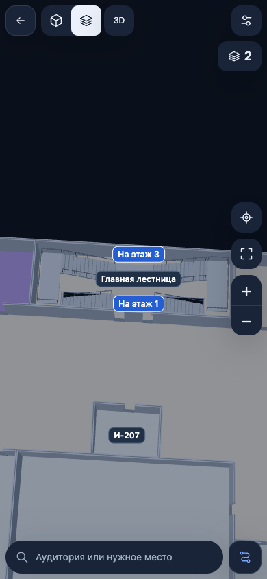

# Вход, уличный переход и главная лестница И — 0.5.24

Новый проход 12 ноября 2026 после 0.5.23. Исторические результаты предыдущих
сборок не подменяют проверки этого выпуска. Приоритет — Android и мобильный веб.

## Что изменено

- Главный вход: ряд двойных дверей, отдельный тамбур с боковыми стенами,
  рамки в проёмах внутренней границы, затем турникеты. Стол охраны слева
  направлен вдоль входа и расположен после рамок до турникетов.
  Отдельный вход с улицы к охране не добавлен. Ориентир «Охрана» не является
  ложной кнопкой. Детали остаются в 2D/3D и при экономном качестве.
- Переход А → И около А‑177.1 показан открытым уличным проходом по прежней
  исходной траектории. Удалены ложные наружные стенки и только перекрывающая
  этот проход низкая оболочка. Покрытие и линия маршрута сохранены;
  шаги отмечают выход на улицу и вход в другой корпус, в обоих направлениях.
- **Только большая главная лестница корпуса И** получила подтверждённую
  пользователем схему: центр → две боковые миниплощадки → общий центр.
  И1 показывает подъём, И2 — подъём и спуск, И3 — приход снизу.
  Перехода выше И3 нет. Каждый вид помещён в свою исходную лестничную клетку.
- На А1 добавлены недостающие нижние виды ЛК‑8 и ЛК‑9 по подписанному
  фотоплану IMG_3219, в собственных исходных контурах.
- Исправлен пропадавший символ остальных лестничных переходов:
  стрелки теперь сохраняются при объединении геометрии сцены.

Точные размеры входного оборудования, число дверей/рамок/турникетов,
высоты и количество ступеней не измерены. Это схематическое отображение
подтверждённого расположения и формы, а не обмер здания.



[И1](evidence/2026-11-12/i-main-1-close.png) ·
[И3](evidence/2026-11-12/i-main-3-close.png) ·
[главный вход](evidence/2026-11-12/entrance-initial.png) ·
[уличный маршрут](evidence/2026-11-12/street-portrait-3d.png)

## Проверки этой сборки

- **911/911 автоматических тестов**, `format:check`, `git diff --check`.
- Аудит всех пяти исходных планов В78: **94 направленные записи / 47
  лестничных связей**. У всех сохранены отображаемый выбираемый маркер,
  целевой этаж и обратный конец; проверена фактическая сборка сцены в 2D/3D.
- Локальный Chrome: улица и маршрут А‑177 → И‑200 в портретном,
  горизонтальном и настольном окне, 2D/3D; новый вход в мобильном и настольном
  окне при низком качестве; И1/И2/И3 и кнопки переходов; А1 ЛК‑8/ЛК‑9.
  Ошибок выполнения в этих сценариях не обнаружено. Это не проверка Safari
  или физических датчиков телефона.
- `mobile:doctor`: Node 24.18.0, JDK 21.0.12.1, Android API 36,
  Build Tools 35.0.0, AGP 8.13.0; требования проекта не снижались.
- Настоящая Gradle Debug-сборка **0.5.24**, `versionCode=17`.
  `mobile:check`: 93 ресурса, 82 файла данных В78.
- Все **93 файла `dist`** совпали по SHA‑256 с содержимым готового
  `APK/assets/public/`; дополнительно проверены только два штатных пустых
  файла Capacitor. Проверены бинарный AndroidManifest, целостность DEX и подпись.

APK: `android/app/build/outputs/apk/debug/app-debug.apk`,
копия `.native-build/release-0.5.24/MIREA-V78.apk`.
Размер **50 813 320 байт** (48,46 MiB).

```text
fe2a2e5a5699f73c71b010b6139a474a9577652784ae4f9dea6072b53a611a46  MIREA-V78.apk
```

Журналы нового прохода: `.native-build/release-0.5.24/` — `tests.log`,
`format.log`, `doctor.log`, `android-build.log`, `mobile-check.log`,
`apk-verification.json`, `outdoor-ui.json`, `entrance-ui.json`.
Расширенный лестничный аудит: `.native-build/stair-pair-audit-2026-11-12/`.
Служебная папка `.native-build` не входит в Git; воспроизводимые тесты и
документированные результаты находятся в репозитории.

## Границы результата

Исходные `public/data`, `source/maps` и граф проходов не менялись. Скрытые
локальные GPS-поправки, личные замеры, подбор размеров здания и изменения
жестов в этот выпуск не включены. Улица использует существующие рёбра;
изолированным А‑177.1 и И‑100 не приписан новый вход. Проверенный пример
уличного маршрута — А‑177 → И‑200 и обратно.

Остаются девять связей, где объёмная форма известна только с одной стороны,
и три пары без подтверждённой формы. Там виден честный символ лестницы.
Ещё 20 моделей не имеют исходной маршрутной связи; по одному совпадению
названия новые переходы не создавались. Полный список и необходимые
уточнения: [аудит лестниц](STAIR_PAIR_AUDIT_2026-11-12.md).

Нативная iOS-сборка в этом проходе не создавалась. Для iPhone предназначен
сайт; проверку на настоящем iPhone/Safari и реальных Android, доступности
лестничных дверей и проходов в вузе необходимо провести отдельно.

## Проверка APK и публикации

Эмулятор `mirea-v78-api36`, `sdk_gphone64_arm64`, Android 16 / API 36,
WebView **133.0.6943.137**: APK установлен поверх 0.5.23 с сохранением данных.
При выключенных Wi‑Fi и мобильных данных холодный запуск завершился за
801 мс по `am start -W`; это время запуска Activity, не измерение полной
отрисовки карты. Подтверждены вход в 2D/3D, виды И1/И2/И3, уличный маршрут
А‑177 → И‑200 и восстановление состояния. Нажатия непосредственно на карте
И1 → И2 → И3 сохранили позицию, цель и масштаб камеры, панель осталась
компактной. На И3 отсутствует кнопка несуществующего продолжения вверх.
Ошибок выполнения в проверенных сценариях, native fatal и ANR не найдено.
Два прежних сообщения Capacitor о safe-area CSS при запуске остаются;
они не вызвали остановки приложения. Снимки и журналы:
`.native-build/release-0.5.24/android-qa/`.

Опубликован код `16b14b2349a5ecdbba6c2e9e8610fc044b827ba7` в `main`;
коммит веб-сборки `bae28c11e5da8afdbcdeff2adebed68268348342` в `gh-pages`.
Проверки [исходников](https://github.com/ShuklinAleksandr/mirea-v78-map/actions/runs/43330912064)
и [публикации сайта](https://github.com/ShuklinAleksandr/mirea-v78-map/actions/runs/43330942062)
завершились успешно. Все **93 опубликованных файла сайта** совпали
по SHA‑256 с локальной веб-сборкой. В действующем сайте повторно пройдены
маршрут от главной лестницы до Г‑424‑4, уличный переход в трёх размерах
экрана и новые виды И1/И2/И3: ошибок выполнения не обнаружено.

[Тестовый выпуск 0.5.24](https://github.com/ShuklinAleksandr/mirea-v78-map/releases/tag/v0.5.24)
содержит APK и `SHA256SUMS.txt`. Размер и SHA‑256 опубликованного APK
совпали с локальным результатом. Исторические отчёты сохранены отдельно.

Подробности: [вход](ENTRANCE_DOORS_2026-11-12.md),
[уличный переход](OUTDOOR_AI_PASSAGE_2026-11-12.md),
[исходный выпуск 0.5.23](ENTRANCE_STAIRS_RELEASE_2026-11-12.md).
