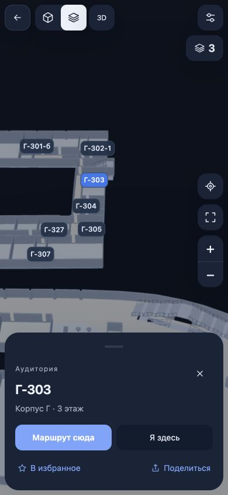
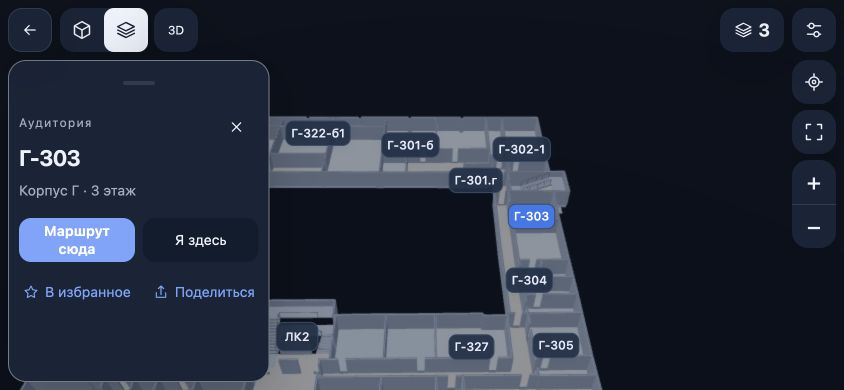

# Единый интерфейс и этажи корпусов — 8 ноября 2026

Новый проход после `v0.5.0-compare.4`. Основные цели: Android и мобильный веб, включая Safari на iOS. Исторические отчёты сравнения двух интерфейсов остаются отдельными документами.

## Что изменено

- Оставлен один интерфейс на основе Новой версии. Выбор «Классика / Новая» удалён из настроек и заголовков. Старые ссылки с `?interface=classic` и `?interface=next` открывают одно приложение. Режимы «Снаружи / Внутри», 2D/3D и «Чистая карта» сохранены.
- Настройки и последняя нативная позиция прежней Классики переносятся, если соответствующая запись Новой отсутствует. Избранное и недавние места объединяются однократно. Исходные записи не удаляются; существующие настройки Новой имеют приоритет.
- На телефоне верхние кнопки собраны в одну строку. Выбор этажа — компактная кнопка с цифрой; название корпуса, этажи и аудитории доступны после нажатия. Области нажатия — не меньше 44 px. Отступы камеры учитывают фактически видимые панели и безопасные зоны экрана.
- Физический этаж уточняется в пределах текущего плана при уверенном наведении карты, ручной точке или принятом прогрессе маршрута. На одном уровне плана А2 соответствует Б3/В3/Г3/Д3. Обновляются подписи и список этажей; другой план не загружается, камера и GPS-точка не переносятся.
- Для определения корпуса используются существующие полигоны, однозначные внутренние компоненты и известные рёбра маршрута. Общие коридоры, границы, дворы, отверстия и неопределённые области сохраняют последний уверенный контекст. Радиус ошибки GPS должен помещаться в известную область. GPS не определяет этаж; реальный переход между уровнями остаётся с подтверждением.
- Ожидание ответа Android/iOS о стартовой ссылке ограничено: зависший нативный ответ больше не блокирует загрузку встроенной карты. Поздняя ссылка не перехватывает уже изменённый пользователем вид.

Жесты и сохранение камеры из [предыдущего прохода](MOBILE_GESTURES_2026-11-08.md) сохранены. Данные карты, геометрия лестниц и граф проходов в этом проходе не изменялись.

## Проверки и выпуск

- `npm run check`: **704/704 теста**, форматирование и веб-сборка прошли. После окончательной правки компактной кнопки landscape повторены форматирование и веб-сборка.
- Проверены все 26 сочетаний корпуса и физического этажа по исходным данным, неопределённые коридоры и отверстия. Интеграционные тесты проверяют А2 → Г3, согласованность подписей и отсутствие изменений геометрии, камеры и GPS-точки. Проверен принятый прогресс GPS-маршрута, пауза после ручного обзора и отказ при плохих/устаревших данных.
- Настоящая Gradle-сборка **0.5.1**, versionCode **5**: `BUILD SUCCESSFUL`, 214 задач, 33 выполнены. `mobile:check` и проверка подписи APK прошли.
- **93/93** встроенных файла `assets/public/` APK совпадают с `dist` по SHA-256. Дополнительно только два пустых служебных файла Cordova.
- APK: **50 701 572 байта**; SHA-256 `96f4161c0d2a94d2afc4adde76229b71815355858bc41a3984ba385e63dcbb3c`.
- APK: `android/app/build/outputs/apk/debug/app-debug.apk`; копия для передачи: `.native-build/single-interface/release/MIREA-V78.apk`. Веб-архив: `.native-build/single-interface/release/MIREA-V78-Web.zip`.
- Браузерная проверка 320×568, 390×844 и 844×390: верхняя строка, выбор физического этажа Г3, список аудиторий корпуса и отсутствие выбора версии.

Журналы этого прохода: `.native-build/single-interface/release/`. Реальный iPhone, нативная iOS device-сборка и TestFlight в этот проход не входят. Полевая точность GPS, полнота связности и архитектурная точность лестниц этим проходом не подтверждаются.

## Публичный сайт и Safari

- GitHub Pages обновлён до **0.5.1**: https://shuklinaleksandr.github.io/mirea-v78-map/ . Сборка Pages завершилась успешно, коммит публикации `f1b602a1a89f9d65bb02fae39598df3278a19cde`, исходный коммит `7ed1f53054eeec92f210ea61db6d073bde6594c1`.
- Полученные с публичного сайта `index.html` и три входных JS/CSS-файла совпали с локальной сборкой. Все **82/82** файла данных Pages совпали с данными Android/dist. Две проверки CI исходной ветки прошли.
- На публичном сайте проверены запуск, поиск Г-303, переход к карточке, физический этаж Г3 и компактная строка в обеих ориентациях.
- Safari **iOS 26.0**, Simulator **iPhone 17 Pro**: окончательная локальная производственная сборка загружается, подсказка Г-303 видна над экранной клавиатурой в портретном и горизонтальном положении, нажатие открывает карточку Г-303 и скрывает клавиатуру. Это испытание Simulator, не настоящего iPhone. Двухпальцевый жест Safari в этом проходе не проверен.
- Журналы сверки: `pages-data.json`, `public-check.json`; снимки Safari: `.native-build/single-interface/web-qa/`.

## Установленный Android APK и передача

- Устройство: собственный эмулятор `mirea-v78-api36`, `emulator-5554`, модель `sdk_gphone64_arm64`, **Android 16 / API 36**, **WebView 133.0.6943.137**. Установлены версия **0.5.1**, код **5**, данные приложения сохранены.
- Холодный запуск без сети прошёл; манифест, планы и поиск загружались из встроенных ресурсов. Переключателя интерфейсов в настройках нет.
- Поиск Г-310, выбор Г3, список этажей 1–4 и аудитории корпуса работают. При повороте карты центр просмотра сместился в А: подпись обновилась с Г3 на А2 в пределах того же плана; выбор Г-313 вернул Г3. Отдельное нажатие подписи выбирает Г-313. Кнопка всех корпусов возвращает обзор и сворачивает панель.
- Три сценария с настоящими событиями Android MotionEvent: асимметричный щипок с подписи в 3D, параллельный поворот 3D, приближение 2D в landscape. По **44 события** на сценарий; результат проверен по снимкам, а не только по успешной отправке событий. Щипок не открыл карточку и не вызвал поворот, отдельный тап работает.
- Подсказки и выбор Г-303 над экранной клавиатурой прошли в обеих ориентациях. Диагностическое приложение удалено; настройки ориентации, клавиатуры, сети и тайм-аута экрана восстановлены.
- В журнале нет fatal/ANR/OOM/JS exception. Эмулятор сообщил `GL_INVALID_ENUM` при старте и предупреждения IME о задержках. Из этого прохода не следует обещание конкретного FPS или отсутствия лагов на слабых телефонах.
- Подробные результаты и исходное/восстановленное состояние: `.native-build/single-interface/qa/README.md`; снимки и журналы в той же папке.

[Тестовый выпуск v0.5.1](https://github.com/ShuklinAleksandr/mirea-v78-map/releases/tag/v0.5.1): [APK](https://github.com/ShuklinAleksandr/mirea-v78-map/releases/download/v0.5.1/MIREA-V78.apk), [веб-архив](https://github.com/ShuklinAleksandr/mirea-v78-map/releases/download/v0.5.1/MIREA-V78-Web.zip), [контрольные суммы](https://github.com/ShuklinAleksandr/mirea-v78-map/releases/download/v0.5.1/SHA256SUMS.txt). Размер веб-архива **45 557 457 байт**, SHA-256 `d26717165158c7f30e26fa932215483de60409bd2d33f01b8ceeac3ea634fbec`. Серверные SHA-256 и размеры обоих загруженных файлов совпали с локальными.

Исходники находятся в `feature/stairs-and-floor-view`, [PR №6](https://github.com/ShuklinAleksandr/mirea-v78-map/pull/6). `main` и чужая базовая ветка автоматически не сливались. Артефакты собраны из `7ed1f53054eeec92f210ea61db6d073bde6594c1`; последующее дополнение документации не меняет код или бинарники.
