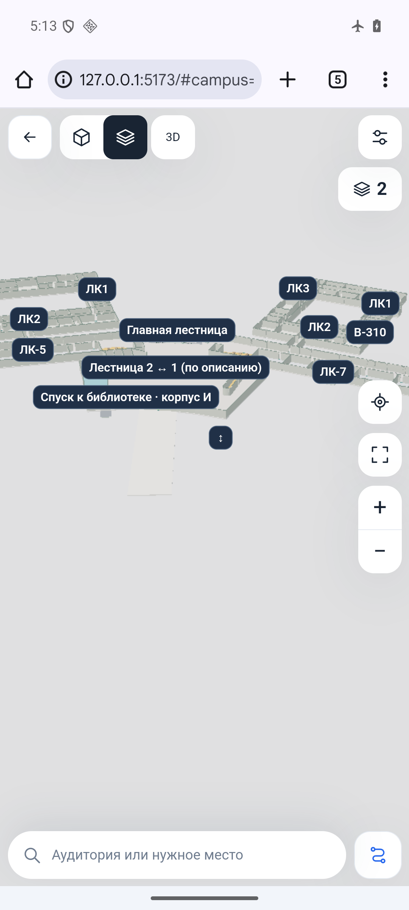
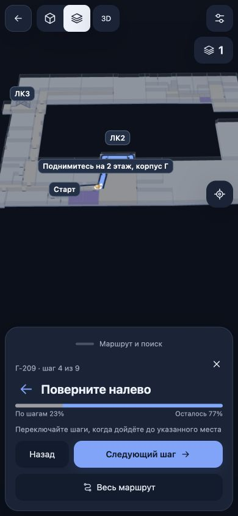

# Наклон 3D и проверка предыдущих пожеланий — 0.5.16

Новый проход от 10 ноября 2026. Это проверка текущих исходников и веб-версии, а не повторное подтверждение исторических APK, iOS-сборок или точности карты в вузе.

## Что выяснилось с телефоном

Пользователь уточнил: приближение и вращение работают, но карта остаётся с видом сверху и нельзя изменить наклон. Сравнение истории показало, что `src/map/gestures.js` не менялся в 0.5.14 и 0.5.15. Последнее изменение до этого исправления — `8dd8840` от 8 ноября, версия 0.5.2: сенсорный обработчик сохранял наклон при любых жестах. В 0.5.15 изменились компоновка компьютера, управление мышью и клавиатурой, отступы камеры; оснований приписывать фиксацию наклона именно этому выпуску нет. Физический телефон пользователя в этом проходе не исследовался.

В 0.5.16:

- Два пальца вместе вверх/вниз меняют наклон 3D. Угол ограничен диапазоном 5–70° от вертикали, камера не уходит под пол.
- Щипок и разворот пальцев продолжают менять масштаб и направление. Небольшое дрожание не переключает режим; заметный щипок или разворот после наклона возвращает обычное масштабирование/вращение без повторного применения старого движения.
- Один палец перемещает карту. В 2D наклона нет, параллельное движение двух пальцев перемещает план.
- Жест, начатый на подписи, продолжает управлять картой. Завершение жеста не открывает случайную карточку.

## Пройденный маршрут

Обнаружен отдельный пробел: серый участок линии обновлялся по принятой геопозиции, но не при ручном просмотре шагов или демонстрации. Теперь он обновляется и при переходах вперёд/назад, и при движении указателя демонстрации. Оставшаяся часть синяя, пройденная/просмотренная — нейтрально-серая.

GPS-прогресс и просмотр хранятся отдельно. Ручной просмотр не записывает выдуманный пройденный путь: подписи различаются («Пройдено», «По шагам», «Просмотрено»). При возврате к геопозиции используется только её подтверждённый прогресс. Плохой GPS не закрашивает новый участок автоматически; лестничный переход по-прежнему подтверждается вручную.

## Аудит основных предыдущих пожеланий

«В коде и тестах» означает наличие реализации и соответствующих автоматических проверок. Это не обещание безошибочной работы на каждом телефоне. Поздние уточнения пользователя имеют приоритет над ранними пожеланиями.

| Пожелание                                                                                        | Текущее состояние и проверка                                                                                                                                                                                                                                                                                       |
| ------------------------------------------------------------------------------------------------ | ------------------------------------------------------------------------------------------------------------------------------------------------------------------------------------------------------------------------------------------------------------------------------------------------------------------ |
| При запуске камера у главного входа                                                              | Сохранено: обычный старт В78 открывает А2 и кадр главного входа. Ссылка на выбранную аудиторию/маршрут сохраняет её назначение. `navigation.test.mjs`, `camera.test.mjs`.                                                                                                                                          |
| Один интерфейс вместо «Классика/Новая»                                                           | В коде и тестах; старые ссылки и сохранённые места мигрируют. `interface-variant.test.mjs`, `ui-controller.test.mjs`.                                                                                                                                                                                              |
| Ненужный режим всех этажей убрать                                                                | В пользовательском интерфейсе убран; отдельные этажи и лестничные переходы сохранены. `ui-controller.test.mjs`.                                                                                                                                                                                                    |
| Компактные кнопки сверху, выбор этажа по нажатию на цифру, возврат ко всем корпусам              | В коде и тестах. `navigation.test.mjs`, `app-surface.test.mjs`.                                                                                                                                                                                                                                                    |
| Выбор корпуса открывает третий, а при его отсутствии верхний этаж                                | В коде и тестах. `building-view.test.mjs`, `floor-context.test.mjs`.                                                                                                                                                                                                                                               |
| Номер этажа меняется при попадании в другой корпус                                               | Используется установленное соответствие физического этажа корпусу, а не только номер исходного плана. Есть проверки переходов точки/маршрута и камеры. `floor-context.test.mjs`. Это не определение высоты по GPS.                                                                                                 |
| При смене этажа не двигать камеру и не открывать панель                                          | В коде и тестах для меню и кнопки на лестнице. `navigation.test.mjs`.                                                                                                                                                                                                                                              |
| Снаружи → внутрь не теряет остальные корпуса и масштаб                                           | Сохранён общий план; камера сохраняет подходящее кадрирование. `building-view.test.mjs`, `camera.test.mjs`, `navigation.test.mjs`.                                                                                                                                                                                 |
| Поиск сразу из нижней строки, маршрут отдельной кнопкой                                          | В коде и тестах. Список корпусов из поисковой панели удалён; аудитории корпуса доступны в контекстном выборе. `ui-controller.test.mjs`, `building-rooms.test.mjs`.                                                                                                                                                 |
| Подсказки до ввода, «Моё местоположение» только в поле «Откуда»                                  | В коде и тестах, включая повторный вход в поля. `ui-controller.test.mjs`, `current-route-origin.test.mjs`.                                                                                                                                                                                                         |
| При вводе только поле, подсказки и клавиатура; доступная панель в обеих ориентациях              | В коде и тестах учтены visual viewport, safe areas, завершение ввода, Safari blur и Android Back. Проверка каждого реального устройства остаётся отдельной задачей. `ui-controller.test.mjs`, `mobile-lifecycle.test.mjs`.                                                                                         |
| Скрывать лишние кнопки при бездействии                                                           | Кнопки карты скрываются через 6 секунд, возвращаются коротким нажатием. Действующий маршрут остаётся доступным. `ui-controller.test.mjs`.                                                                                                                                                                          |
| Подсказка «штаны» → главная лестница, ближайшие еда/туалеты с корпусом и расстоянием             | В коде и тестах. Расстояния зависят от исходной позиции и геометрии; это не доказательство прохода через стены. `place-search.test.mjs`, `next-nearby-places.test.mjs`, `search-nearby-ui.test.mjs`.                                                                                                               |
| Цвета категорий, единый шрифт и рамка подписей                                                   | В коде и тестах. `room-labels.test.mjs`, `next-rendering.test.mjs`. Все подписи одновременно при любом отдалении **не показываются**: перекрывающиеся скрываются ради читаемости. Это ограничение отличается от буквального пожелания «всегда все подписи».                                                        |
| Подписи лестниц и близкие кнопки перехода «на N этаж»                                            | В коде и тестах, включая парные лестницы и известные назначения. `stair-labels.test.mjs`, `navigation.test.mjs`. Неизвестный цоколь не превращён в выдуманный план.                                                                                                                                                |
| Убрать дальние дороги, лужайку, посторонние объекты и тени                                       | Оставлены здания и ближайшие дороги, тени отключены во всех пресетах. `exterior.test.mjs`, `rendering.test.mjs`. Отсутствие мерцания на всех графических драйверах не подтверждено.                                                                                                                                |
| Настоящие отличия 2D/3D, качество/FPS, баланс по умолчанию                                       | 2D имеет отдельную плоскую геометрию и ортографическую камеру; пресеты меняют плотность отрисовки и детализацию, есть ограничение FPS. Баланс по умолчанию. `map-plan-rendering.test.mjs`, `rendering.test.mjs`, `ui-controller.test.mjs`.                                                                         |
| Плавнее переключать корпуса и этажи, ограничить отдаление                                        | Есть кэширование геометрии этажей и лестниц, объединение объектов, отложенная отрисовка и предел отдаления. `floor-display-cache.test.mjs`, `stair-display-cache.test.mjs`, `camera.test.mjs`. Стабильные 60 FPS на любых слабых устройствах не обещаются.                                                         |
| Красивее лестницы, без рваных сканов/дыр                                                         | В текущей карте используется подготовленная структурная геометрия; проверки проёмов, прибывающих маршей, перегородок и библиотечной лестницы сохранены. `stair-structural-display.test.mjs`, `stair-opening-view.test.mjs`, `library-stair.test.mjs`. Архитектурная точность всех лестниц и цоколя не установлена. |
| GPS во всех видах, направление взгляда, приближение и сопровождение камеры                       | В коде и тестах; направление зависит от разрешений и доступных датчиков. `tracking-watch.test.mjs`, `heading.test.mjs`, `location-scene.test.mjs`.                                                                                                                                                                 |
| Привязка к линии, автоматические шаги, движение назад, ручные лестницы                           | В коде и тестах; плохой/неоднозначный сигнал не подтверждает новый прогресс. `route-tracking.test.mjs`, `route-tracking-surface.test.mjs`, `ui-controller.test.mjs`. Нужен повторный проход в вузе; точный GPS внутри здания не гарантирован.                                                                      |
| Камера плавно следует за поворотами, контрольные точки, мягкое сообщение при уходе, вперёд/назад | Реализовано в 0.5.14, сохранено. `route-guidance-scene.test.mjs`, `route-scene.test.mjs`, `next-route.test.mjs`. Тесты используют заданные последовательности координат; это не измерение реального GPS.                                                                                                           |
| Серым пройденный путь, синим остаток и индикатор прогресса                                       | GPS уже поддерживался; ручные шаги и демонстрация дополнены в 0.5.16. `route-scene.test.mjs`, `route-guidance-scene.test.mjs`, `next-route.test.mjs`, `ui-controller.test.mjs`.                                                                                                                                    |
| Г-424-1/Г-424-3 и похожие вложенные кабинеты                                                     | Учтён подтверждённый вход через Г-424, внутренний участок без известной двери не нарисован по догадке. Для остальных сохранён список вопросов; пользователь отложил исправление до сверки. [Аудит маршрутов](ROUTING_ENTRANCE_AUDIT_2026-11-08.md), [вопросы](ROUTE_QUESTIONS_2026-11-08.md).                      |
| Удалить замеры Wi-Fi из приложения                                                               | Убраны из действующего интерфейса; старые исходники и исторические материалы не выдаются за активную функцию. `wifi-survey-ui.test.mjs`.                                                                                                                                                                           |
| Работа на ПК без ухудшения телефона                                                              | Компоновка ПК, мышь и клавиатура из 0.5.15 сохранены; мобильная панель остаётся адаптивной. `desktop-navigation.test.mjs`, `map-gestures.test.mjs`, `ui-controller.test.mjs`.                                                                                                                                      |

## Что остаётся неподтверждённым или отложенным

- Точность GPS и привязки плана на месте, движение и направление на реальном iPhone/Android внутри вуза. Ручное уточнение не делает шумный GPS точным.
- Полная связность маршрутов до каждого кабинета. Связи через неизвестные двери не добавляются; список вопросов остаётся открытым.
- Геометрические размеры всех лестниц и подтверждённый план цоколя. Буфеты/проходы содержат пользовательские уточнения, но геодезическая точность не заявляется.
- Уточнение туалетов и Unifood отложено пользователем.
- Новые APK и нативная iOS-сборка в этом проходе не создавались. Старый APK v0.5.5 не содержит веб-изменений 0.5.16. Для настоящего iPhone нужны отдельная development-подпись и устройство; TestFlight — отдельный выпуск владельца.
- Холодный запуск сайта без интернета не реализован. Для iPhone доступна веб-ссылка и добавление на экран «Домой», это не IPA.

## Проверки этого прохода

- 126 целевых автоматических тестов прошли: жесты, сцена маршрута, ручной/GPS-прогресс и управление интерфейсом.
- Полный `npm run check`: форматирование, **780/780 тестов**, production-сборка прошли. Существующее предупреждение сборщика о разных формах импорта `gps-registration.json` осталось; сборку оно не прерывает.
- Chrome 133.0.6943.137, Android 16/API 36, тестовый эмулятор `mirea-v78-api36` (`sdk_gphone64_arm64`), 1080×2400: выполнены настоящие двухконтактные MotionEvent-жесты через Android SDK. По снимкам подтверждены наклон в обе стороны и совместные щипок/поворот. Это эмулятор, не физический телефон и не Safari.
- Во встроенном браузере на 390×844 проверен маршрут Г-103-1 → Г-209: на четвёртом шаге индикатор и линия показывают 23%, возврат на третий возвращает 1%. Это ручной просмотр, а не подставная геопозиция.
- Локальные журналы и снимки: `.native-build/mobile-tilt-2026-11-10/`. Исторические проверки других версий этим не заменяются.

