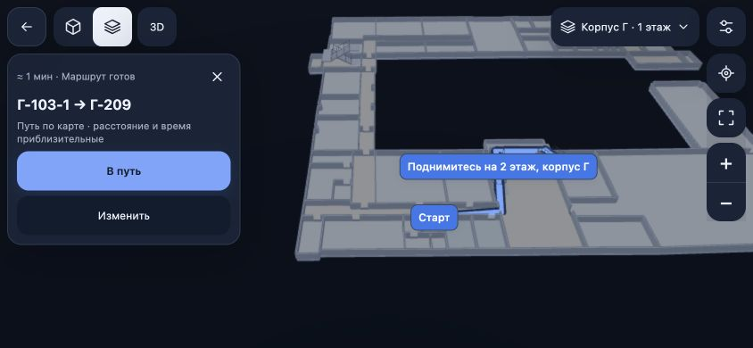
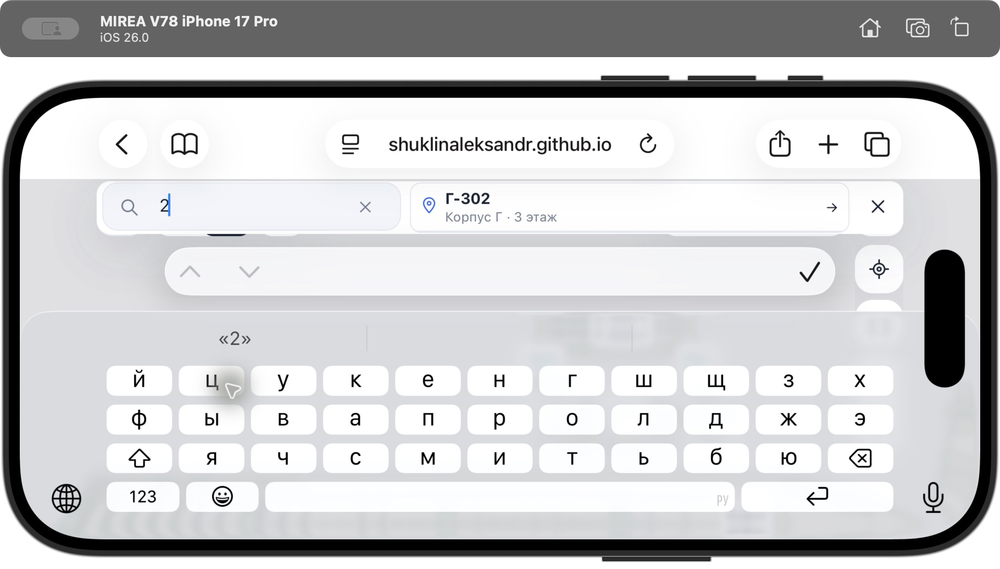

# Мобильная веб-публикация и горизонтальный экран — 8 ноября 2026

Это новый проход после `v0.5.0-compare.2`; старые журналы и контрольные суммы не используются как доказательство текущих сборок. Рабочая ветка `feature/stairs-and-floor-view`, PR #6. Объединение в `main` не выполнялось.

## Результат

- Публичная HTTPS-карта: https://shuklinaleksandr.github.io/mirea-v78-map/ . Компьютер автора не нужен; iPhone открывает её в Safari. Варианты `?interface=classic` / `?interface=next` входят в один сайт. Нативный iPhone IPA и TestFlight в этом проходе не собирались.
- «Все корпуса» возвращает к кампусу из выбранного здания или этажа и сворачивает панель; название варианта над картой убрано, переключатель остаётся в Настройках.
- В обеих версиях горизонтальный экран использует компактные значки с областями нажатия 44 px, одну боковую полосу поиска/маршрута, отдельную кнопку свёрнутого поиска и доступные этажи. Камера учитывает фактическую ширину панели и карточки маршрута.
- Поле поиска и подсказки учитывают `visualViewport` и Android `adjustResize`, включая поворот с открытой клавиатурой. При очень малой высоте горизонтального Safari поле и список располагаются рядом. Дополнительный ориентир в короткой полосе доступен после выбора в карточке; название, корпус/этаж и имеющееся расстояние остаются в результатах.
- Исправлено нажатие подсказки Safari: закрытие клавиатуры больше не сдвигает результат до обработки выбора. Касание и прокрутка разделены; поиск и оба поля маршрута используют одно поведение.
- [Полное сравнение интерфейсов](INTERFACE_COMPARISON.md) сверено с реальными ветвлениями кода. Карта, граф маршрутов, GPS и существующая автосмена шагов общие; Новая не повышает точность GPS.

## Проверки и сборки

- `npm run check`: **656/656** тестов, форматирование и производственная веб-сборка прошли. Первая попытка в ограниченном окружении не могла открыть локальные порты тестового сервера; полный повтор с разрешённым локальным сервером прошёл.
- Ресурсы перенесены в мобильные проекты и проверены: 93 файла, 82 файла данных. Существующий Android launcher выполнил настоящую Gradle-компиляцию; `apksigner verify` прошёл.
- В готовом APK **93/93** файла `assets/public/` совпадают с `dist/` по SHA-256; дополнительно только два пустых файла Cordova. Имена ZIP AAPT прочитаны как UTF-8, содержимое файлов не преобразовывалось.
- APK: `50,708,834` байт; SHA-256 `372d16d52d187b637e7b96d240d53464e2fdd61f065160ae6f605150f48974a4`.
- Файлы: `.native-build/mobile-share/MIREA-V78-Classic-Next.apk`, `.native-build/mobile-share/MIREA-V78-Classic-Next-Web.zip`, `.native-build/mobile-share/SHA256SUMS.txt`. Стандартный APK: `android/app/build/outputs/apk/debug/app-debug.apk`.
- Журналы: `.native-build/mobile-share/web.log`, `sync.log`, `mobile-check.log`, `android.log`, `apk-signature.log`, `android-assets.json`; публикация: `.native-build/github-pages/build.log` и `deploy.log`.

## Проверка интерфейса

- Браузер: Classic/Next, горизонтальные 844×390 и узкий 568×320; маршрут Г-103-1 → Г-209, компактное ведение, открытие полного маршрута, поля маршрута, сворачивание поиска, возврат к кампусу. Это проверка интерфейса, не физического прохождения пути.
- Safari iOS 26.0 на Simulator iPhone 17 Pro: портрет, горизонтальный экран и настоящая экранная клавиатура. Воспроизведены и исправлены перекрытие подсказок и потеря первого нажатия. После исправления одно нажатие результата А-209 закрыло клавиатуру, открыло карточку и переключило корпус/этаж; карта осталась видна справа. Снимки: `.native-build/mobile-share/ios-keyboard-portrait.jpg`, `ios-keyboard-landscape.jpg`, `ios-keyboard-selected.jpg`.
- Предыдущая проверка APK до финальной адаптации находится в `.native-build/mobile-share/android-qa/README.md`; её контрольная сумма отличается. Финальный APK с указанным выше SHA проверен отдельно: Android 16/API 36, эмулятор `sdk_gphone64_arm64`, WebView 133.0.6943.137. Реальная клавиатура: поиск и выбор подсказки в Classic/Next, портрет/горизонтальный экран; оба поля маршрута в горизонтальном экране. Подсказки видны над Gboard, выбор открывает карточку или задаёт точку маршрута. Журнал и снимки: `.native-build/mobile-share/android-landscape-qa/`. Это эмулятор, не физический телефон.

## Проверка опубликованного сайта

Исходный коммит приложения `c7e44bbe301c456d7ae6e8b167114948f8e49656`; публикация `gh-pages` — `4bbd874f6d37926baecd67cbf6a4d1ecd218777a`. В локальной сборке публикации 82/82 файла данных совпали с производственной проекцией В78. По HTTPS отдельно скачаны и сверены 12 файлов запуска: HTML, manifest, build-info, JS, CSS и оба worker-файла; все SHA совпали с подготовленным сайтом (`.native-build/github-pages/public-check.json`).

По публичной ссылке построен маршрут Г-103-1 → Г-209; ошибок браузера не зафиксировано. Safari Simulator проверил Новую версию по HTTPS: поиск с открытой горизонтальной клавиатурой, выбор Г-302 одним нажатием, возврат ко всем корпусам; затем восстановлен обычный портретный режим.

## Данные публикации

В сайт и APK включается только В78; архив исходных площадок сохранён. Из выпускаемых JPEG удаляются EXIF/XMP/IPTC и комментарии без перекодирования изображения. На 58 фото сохранены сжатые пиксели и цветовые профили; удалено 169 394 байта метаданных. Оригинальные фотографии в исходном архиве не изменялись. Это не очистка истории Git.

Сайт собирается с `BUILD_BASE=/mirea-v78-map/` в `.native-build/github-pages/site`, отдельно от корневого `dist/` мобильных приложений. `build-info.json` опубликованного сайта указывает исходный коммит; ветка `gh-pages` содержит только готовые публичные файлы. Рабочую ветку и PR это не объединяет автоматически.

## Ограничения

Реального iPhone или Android-телефона в этом проходе не было. Работа датчиков, GPS при ходьбе, фактическая связность и доступность проходов в вузе не подтверждены этими испытаниями. План цоколя, допущения высот и карта лестниц сохраняют ограничения предыдущих отчётов. Для веб-версии автономный холодный запуск без сети не реализован; Android содержит ресурсы локально. Нативный iPhone требует отдельной development-подписи владельца и устройства; TestFlight — отдельного архива и учётной записи разработчика.
