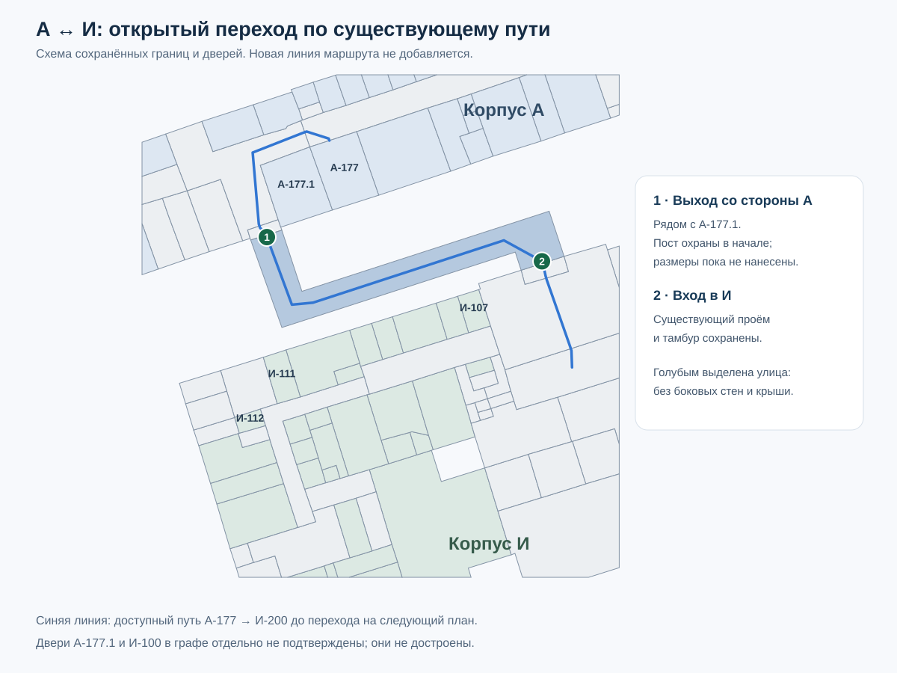

# Открытый переход А ↔ И — 12 ноября 2026

Пользователь уточнил: существующая линия от А-177.1 к корпусу И совпадает с реальным путём, но проходит **по улице**. В начале со стороны А находится пост охраны. Корпус И не является ИВЦ.

## Что изменено

На исходном плане `v-78-floor1` открытый участок — `v-78-floor1-area-604`. Это существующий L-образный полигон между двумя сохранёнными входами:

| Сторона            | Вестибюль              | Дверное ребро    | Исходный проём |
| ------------------ | ---------------------- | ---------------- | -------------- |
| А, рядом с А-177.1 | `v-78-floor1-area-124` | `v-78:edge:8915` | `66n`          |
| И                  | `v-78-floor1-area-437` | `v-78:edge:9143` | `66o`          |

В отображении участок обозначен как открытый переход. Убраны шесть его боковых стенок; обе двери и четыре прилегающих к ним участка стен вестибюлей сохранены. На общем наружном виде убрана только низкая оболочка над этим участком, без удаления соседних помещений и более высоких объёмов. Уличная поверхность объединяется с близкими дорогами, чтобы не создавать наложенных мерцающих плоскостей. При выборе А или И переход остаётся видимым.

Ручная отметка на улице не получает номер кабинета или корпус только потому, что этот корпус выбран в интерфейсе. Экспериментальные GPS-поправки не затрагивались.

Маршрут сохраняет исходные узлы, двери, рёбра, длины и повороты. Добавлены инструкции выхода на улицу и входа в целевой корпус. Пост охраны пока описан в сведениях об участке: конкретный стол, его габариты и проход вокруг него по догадке не строятся.

## Проверки и границы

Исправление применяется только к сохранённому В78-плану с совпадающими ID, контрольной суммой источника и контуром. Изменившийся или чужой исходник не получает старую поправку. Полные `public/data` и `source/maps` не редактируются.

Проверены направления **А-177 → И-200** и **И-200 → А-177**: оба используют прежний уличный участок и новые указания. Граф не изменился. Самостоятельный путь **А-177.1 → И-100** остаётся недоступным: у этих двух записей отдельно отсутствуют подтверждённые внешние связи. Их двери не дорисовывались. А-177.1 — ориентир у выхода, а не новая автоматически доступная точка начала маршрута.

77 целевых проверок отображения, выбора поверхности, маршрутов, этажей и лестничных модулей прошли. Проверены сохранение исходников, двух вестибюлей и высоких объёмов, отсутствие новых рёбер, порядок уличных указаний, обратное направление, отказ от устаревшей привязки и доступность поверхности при выборе обоих корпусов.

Локальные результаты: `.native-build/entrance-corridor-2026-11-12/audit.json`, `outdoor-passage-plan.png`. Схема основана на существующих координатах модели; размеры и высоты не являются новым обмером здания.
