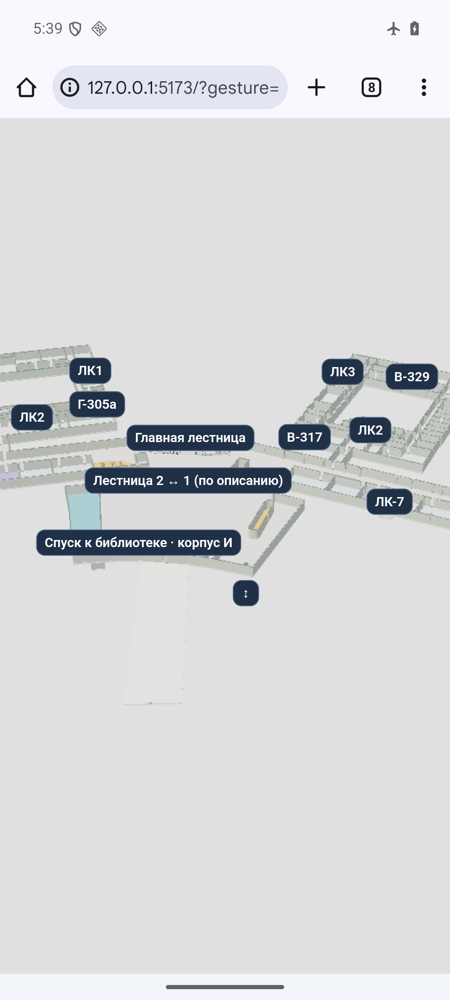

# Жесты телефона — 0.5.17

Проверка от 10 ноября 2026 после замечания о конфликте наклона и поворота в 0.5.16.

## Причина и исправление

В 0.5.16 масштаб и поворот применялись ещё до распознавания наклона. Затем длинный неровный вертикальный жест мог превратиться в вращение из-за накопленного смещения пальцев. Кроме того, наклон сопровождался перемещением карты, а чувствительность зависела от высоты окна и была выше в горизонтальной ориентации.

Теперь:

- Перед началом действия есть небольшая зона нечувствительности. Наклон распознаётся по согласованному вертикальному движению обоих пальцев; один неподвижный палец с движением второго не считается наклоном.
- Начатый наклон фиксируется до изменения количества касаний. Неровное движение не переключает его на вращение или масштаб. Для другого действия нужно отпустить пальцы и начать новый жест.
- Наклон происходит вокруг одного участка карты без одновременного перетаскивания. Чувствительность — 0,2° на CSS-пиксель в обеих ориентациях, пределы 5–70° от вертикали.
- Щипок и вращение могут работать одновременно, но у каждого свой порог против дрожания (6% изменения масштаба и 6° вращения). После распознавания они следуют за пальцами непрерывно.
- Если события двух пальцев попали в соседние кадры, обработчик даёт второму один кадр на обновление, прежде чем выбирать действие. Финальное отпускание обрабатывается сразу.
- Перенос одним пальцем, управление мышью, клавиатура и плоский 2D сохранены. Новый обработчик не добавляет постоянный цикл отрисовки.

## Привычная схема управления

Один палец — перемещение, щипок — масштаб, разворот пары — поворот. Два пальца рядом, вниз/вверх — увеличение/уменьшение наклона. Именно направление наклона соответствует [документации Google Maps](https://developers.google.com/maps/documentation/android-sdk/controls#tilt_gestures); оно изменилось относительно 0.5.16. Поддержка щипка и вращения также описана в [справке Яндекс Карт](https://yandex.ru/support/m-maps/ru/customize-map). Пороговые значения и фиксация действия — наше решение для этой карты, а не заявление об идентичном алгоритме Google или Яндекса.

## Область проверки

Результаты этого прохода записываются отдельно в `.native-build/touch-intent-2026-11-10/`. Проверки эмулятора и автоматические тесты не подтверждают удобство на каждом физическом телефоне. Новый APK и нативная iOS-сборка в этом проходе не создаются; обновляются исходники и мобильный сайт.

- `npm run check`: форматирование, **790/790 тестов** и production-сборка прошли. Среди них 46 проверок сенсорного обработчика: дрожание, один неподвижный палец, события в соседних кадрах, изменение числа касаний, 2D/3D, обе ориентации, переход через ±180° и совместные щипок/поворот. Существующее предупреждение об импорте JSON не прерывает сборку.
- Chrome 133.0.6943.137, Android 16/API 36, эмулятор `mirea-v78-api36`, 1080×2400. Настоящие двухконтактные MotionEvent-жесты через Android SDK: вертикальный наклон с накопленным дрейфом 15° и изменением расстояния между пальцами; новый щипок с дрейфом 3°; новый поворот с небольшим изменением расстояния. По снимкам проверены наклон без ухода в другое действие, отдельные масштабирование и вращение.
- Настоящий iPhone/Safari и физические Android в этом проходе не проверялись. Новое поведение не объявляется «идеальным на всех телефонах».

