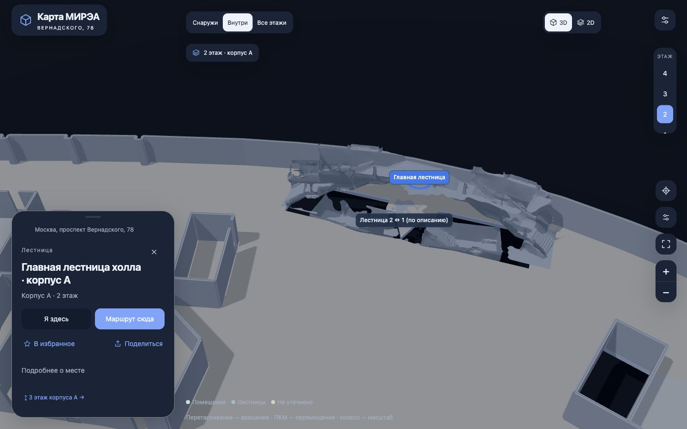

# Новый проход 28 октября 2026

- Общая сборка `2026-10-28T18-20-40-233Z`: 550/550 тестов, одна синхронизация, mobile:check, настоящие Android Debug и iOS Simulator компиляции. [status.json](status.json).
- Отдельная сверка фактических файлов: [native-artifacts.json](native-artifacts.json), 93/93 ресурса совпали с dist на каждой платформе. APK SHA-256: `ca2c0ebbbb92cad55c305c6ac43031f2f255ea0ac9c5e463a3cee53e11a74b9d`, 53 915 300 байт. Три скана и их исходные SHA найдены в новом JS.
- [Android](android-report.json): Android16/API36, WebView133.0.6943.137, sdk_gphone64_arm64/SwiftShader; холодный запуск без сети, новый скан и маршрут Г-103-1 → Г-209.
- [iOS Simulator](ios-report.json): iPhone17Pro/iOS26, установка и запуск, 93/93 установленных ресурсов, поиск, карточка и маршрут. Аппаратный ввод проверен; свайп переноса через CUA не дал видимого сдвига, причина не установлена. Экранная клавиатура, два касания и реальные датчики не подтверждены.

Журналы полной сборки находятся в локальном `.native-build/macos/2026-10-28T18-20-40-233Z/`; в полном передаваемом комплекте — `04-Verification/build/`. Абсолютные пути в JSON описывают компьютер этого прохода, а не компьютер получателя.

[Новый скан на Android](android-standard-scan.png), [маршрут на iOS Simulator](ios-route.png).

Подробности, ограничения привязки и открытые вопросы — [отчёт сканов](../../SCANNED_STAIRS_2026-10-28.md). Симулятор не является подписанной сборкой для настоящего iPhone. Полевой GPS, этаж, архитектурная точность и все маршруты этими проверками не подтверждаются.
