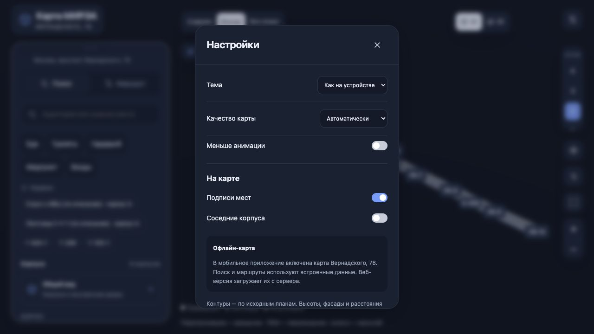

# Проверки очищенного интерфейса · 1 ноября 2026

557/557 тестов и 4/4 Android JUnit прошли; обе платформы скомпилированы, 93/93 ресурса каждой совпадают с dist. Новый APK запущен без сети на тестовом Android, новая App установлена и запущена в iOS Simulator. Настройки проверены визуально.

[Подробный отчёт](../../INTERFACE_CLEANUP_2026-11-01.md) · [Статус сборки](status.json) · [Сверка ресурсов](native-artifacts.json) · [UI QA](ui-qa.json)

[Android](android-settings.png) · [iOS Simulator](ios-settings.jpg). Настоящие телефоны этим проходом не подтверждены.
